# From unfamiliar reports to traceable values

**The model interprets layout. Code reads the amounts.**

Source evidence stays attached through JSON, workbook and review.

---

# Capture evidence before assigning meaning

One Excel cell, three linked facts.

**Stable handle · untouched source value · exact location**

Example fields from the native Excel evidence format.

---

# Map the meaning. Retrieve the amount.

A section rule maps column B across matching asset rows.

**Preserve printed discrepancies. Abstain when evidence is missing.**

One example output; the section rule applies across the table.
